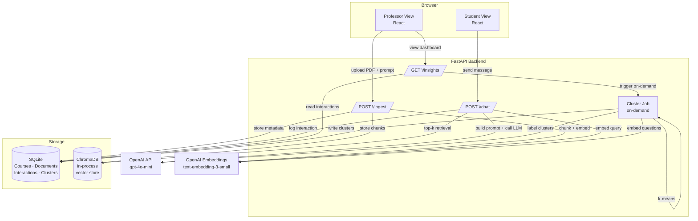

# AI Tutor — 3-Hour Hackathon Implementation Plan

---

## 1. Pitch

**AI Tutor** is a web platform that lets professors ground an AI teaching assistant exclusively in their own course material, then surfaces aggregate insights about where students are struggling — without tracking individuals.

Students get a Socratic tutor that nudges them to think before handing over answers. Professors get a dashboard showing which topics are hard, not a surveillance feed of who asked what. The system amplifies human intelligence by scaffolding reasoning rather than replacing it, and preserves essential academic skills — critical thinking, problem-solving, synthesis — by defaulting to guided discovery over instant answers.

> *"The AI doesn't think for you; it helps you think better."*

---

## 2. Scope

### MVP (must demo in 3 hours)
- Role toggle: **Professor view** / **Student view**
- Professor: create course, upload PDFs, edit tutor prompt, view insights dashboard
- Student: chat with tutor for a selected course
- RAG pipeline: PDF chunking → embeddings → ChromaDB retrieval → grounded answer with page citations
- Socratic mode (on/off toggle in professor settings) — hints + guiding questions by default
- Interaction logging (SQLite)
- Question clustering (k-means on embeddings) with LLM-generated cluster labels
- Responsible-AI UI elements: transparency notice, citations, thumbs up/down, pseudonymisation note

### Nice-to-have (only if time permits)
- Streaming responses (`text/event-stream`)
- Groundedness/confidence indicator per answer
- Export insights as CSV
- Seeded demo data (pre-loaded course + ~30 sample questions)

### Explicitly out of scope
- Real authentication / per-user accounts
- Multi-turn memory beyond the current session
- Production deployment / HTTPS / rate-limiting
- Mobile-responsive polish

---

## 3. Architecture



**Components:**

| Component | Role |
|---|---|
| **React (Vite) + Tailwind** | Single-page app with role toggle. Two "views" are just conditional renders. |
| **FastAPI** | REST API, runs the RAG pipeline, clustering, and logging. |
| **ChromaDB (in-process)** | Persistent vector store — no separate service, data lives in `./chroma_db/`. |
| **SQLite** | Lightweight relational store for courses, documents, interactions, and cluster results. |
| **OpenAI `text-embedding-3-small`** | Cheap, fast embeddings for both document chunks and student questions. |
| **OpenAI `gpt-4o-mini`** | Low-latency, low-cost LLM for answers and cluster labelling. |

---

## 4. Tech Stack

| Layer | Choice | Why |
|---|---|---|
| **Backend** | Python 3.11 + FastAPI | Fastest Python API framework; async support; built-in OpenAPI docs for debugging |
| **Frontend** | React 18 (Vite) + Tailwind CSS | Vite starts in <1s; Tailwind avoids writing CSS; both are team-familiar |
| **Vector store** | ChromaDB (embedded mode) | Zero infrastructure — imports like a library, persists to disk |
| **Relational DB** | SQLite via `sqlalchemy` | No server to start; file-based; enough for a demo |
| **PDF parsing** | `PyMuPDF` (`fitz`) | Fast, returns page numbers, handles multi-column PDFs better than `pdfplumber` |
| **Embeddings + LLM** | OpenAI API | One API key, no local GPU needed |
| **Clustering** | `scikit-learn` KMeans | Ships with Python; deterministic; k-means on 30–200 questions runs in milliseconds |
| **Charts** | Recharts | Tiny React charting library; no config needed |
| **Dev runner** | Two terminals (or `honcho`) | Simpler than Docker for a 3-hour hackathon |

---

## 5. Data Model

### SQLite tables (SQLAlchemy models)

```
Course
  id          INTEGER PK
  name        TEXT NOT NULL
  tutor_prompt TEXT          -- professor-defined behaviour instructions
  socratic    BOOLEAN DEFAULT TRUE
  created_at  DATETIME

Document
  id          INTEGER PK
  course_id   INTEGER FK → Course.id
  filename    TEXT
  num_pages   INTEGER
  uploaded_at DATETIME

Interaction
  id          INTEGER PK
  course_id   INTEGER FK → Course.id
  session_id  TEXT          -- UUID generated client-side, never linked to identity
  question    TEXT
  answer      TEXT
  sources     TEXT          -- JSON: [{doc, page, snippet}, ...]
  feedback    INTEGER       -- NULL | 1 (👍) | -1 (👎)
  timestamp   DATETIME

Cluster
  id          INTEGER PK
  course_id   INTEGER FK → Course.id
  label       TEXT          -- LLM-generated short label
  size        INTEGER
  example_questions TEXT    -- JSON: [str, ...]
  is_gap      BOOLEAN       -- TRUE if most questions were out-of-scope
  computed_at DATETIME
```

### ChromaDB collection

```
Collection name: "chunks_<course_id>"
  id          str           -- "<doc_id>_p<page>_c<chunk_idx>"
  embedding   float[]       -- text-embedding-3-small (1536 dims)
  document    str           -- raw chunk text
  metadata:
    doc_id    int
    filename  str
    page      int
    course_id int
```

---

## 6. API Endpoints

### Courses

| Method | Path | Request | Response |
|---|---|---|---|
| `GET` | `/courses` | — | `[{id, name, socratic}]` |
| `POST` | `/courses` | `{name, tutor_prompt, socratic}` | `{id, name}` |
| `PATCH` | `/courses/{id}` | `{tutor_prompt?, socratic?}` | `{ok: true}` |

### Documents / Ingestion

| Method | Path | Request | Response |
|---|---|---|---|
| `POST` | `/courses/{id}/ingest` | `multipart/form-data` PDF file | `{doc_id, num_chunks}` |
| `GET` | `/courses/{id}/documents` | — | `[{id, filename, num_pages}]` |

### Chat

| Method | Path | Request | Response |
|---|---|---|---|
| `POST` | `/chat` | `{course_id, session_id, question}` | `{answer, sources:[{filename,page,snippet}], interaction_id}` |
| `POST` | `/interactions/{id}/feedback` | `{value: 1 or -1}` | `{ok: true}` |

### Insights

| Method | Path | Request | Response |
|---|---|---|---|
| `GET` | `/courses/{id}/insights` | — | `{clusters:[{label,size,examples,is_gap}], total_questions, gap_count}` |

> `GET /insights` triggers clustering on-demand if the last run is stale (>5 min or new interactions exist).

---

## 7. Key Implementation Details

### 7.1 PDF Ingestion and Chunking

```python
# backend/ingest.py
import fitz  # PyMuPDF
from typing import Generator

CHUNK_SIZE = 400      # tokens ≈ chars / 4
CHUNK_OVERLAP = 80

def iter_chunks(pdf_path: str) -> Generator[dict, None, None]:
    doc = fitz.open(pdf_path)
    for page_num, page in enumerate(doc, start=1):
        text = page.get_text("text").strip()
        if not text:
            continue
        words = text.split()
        step = CHUNK_SIZE - CHUNK_OVERLAP
        for i in range(0, max(1, len(words) - CHUNK_OVERLAP), step):
            chunk = " ".join(words[i : i + CHUNK_SIZE])
            if len(chunk) < 30:
                continue
            yield {"text": chunk, "page": page_num}

def ingest_pdf(pdf_path: str, doc_id: int, course_id: int, filename: str,
               chroma_collection, openai_client):
    chunks = list(iter_chunks(pdf_path))
    texts = [c["text"] for c in chunks]
    # Batch embed (max 2048 items per call)
    resp = openai_client.embeddings.create(
        model="text-embedding-3-small", input=texts
    )
    embeddings = [r.embedding for r in resp.data]
    ids = [f"{doc_id}_p{c['page']}_c{i}" for i, c in enumerate(chunks)]
    metadatas = [{"doc_id": doc_id, "filename": filename,
                  "page": c["page"], "course_id": course_id}
                 for c in chunks]
    chroma_collection.add(ids=ids, embeddings=embeddings,
                          documents=texts, metadatas=metadatas)
    return len(chunks)
```

---

### 7.2 Retrieval + Answer Prompt Template

```python
# backend/rag.py
SYSTEM_PROMPT = """\
You are an AI Tutor for a university course. You answer ONLY using the context
passages provided below. Each passage includes a source tag [filename, p.PAGE].

Rules:
1. Cite every claim with its source tag, e.g. "...momentum is conserved [slides.pdf, p.4]."
2. If the answer is not in the provided passages, reply EXACTLY:
   "I'm sorry, that topic doesn't appear to be covered in the course material."
   Do not guess or use outside knowledge.
3. Keep answers clear and concise (≤ 200 words unless the student asks to expand).
4. {socratic_instruction}
"""

SOCRATIC_ON = (
    "Use the Socratic method: give a guiding hint or ask a clarifying question "
    "first. Only provide the full explanation if the student explicitly asks for "
    "more detail or says they're stuck."
)
SOCRATIC_OFF = "Provide clear, direct explanations."

def build_messages(question: str, chunks: list[dict],
                   professor_prompt: str, socratic: bool) -> list[dict]:
    socratic_instruction = SOCRATIC_ON if socratic else SOCRATIC_OFF
    system = SYSTEM_PROMPT.format(socratic_instruction=socratic_instruction)
    if professor_prompt:
        system += f"\n\nAdditional instructor instructions:\n{professor_prompt}"

    context_lines = []
    for c in chunks:
        tag = f"[{c['metadata']['filename']}, p.{c['metadata']['page']}]"
        context_lines.append(f"{tag}\n{c['document']}")
    context = "\n\n---\n\n".join(context_lines)

    user_msg = f"Context passages:\n\n{context}\n\nStudent question: {question}"
    return [
        {"role": "system", "content": system},
        {"role": "user",   "content": user_msg},
    ]

def chat(course, question: str, chroma_collection, openai_client,
         db_session, session_id: str) -> dict:
    # 1. Embed question
    q_emb = openai_client.embeddings.create(
        model="text-embedding-3-small", input=[question]
    ).data[0].embedding

    # 2. Retrieve top-5 chunks
    results = chroma_collection.query(
        query_embeddings=[q_emb], n_results=5,
        include=["documents", "metadatas", "distances"]
    )
    chunks = [{"document": d, "metadata": m}
              for d, m in zip(results["documents"][0], results["metadatas"][0])]

    # 3. Build prompt and call LLM
    messages = build_messages(question, chunks, course.tutor_prompt, course.socratic)
    resp = openai_client.chat.completions.create(
        model="gpt-4o-mini", messages=messages, max_tokens=400
    )
    answer = resp.choices[0].message.content

    # 4. Extract cited sources for the UI
    sources = [{"filename": c["metadata"]["filename"],
                "page": c["metadata"]["page"],
                "snippet": c["document"][:120] + "…"}
               for c in chunks]

    # 5. Log interaction
    interaction = Interaction(
        course_id=course.id, session_id=session_id,
        question=question, answer=answer,
        sources=json.dumps(sources), timestamp=datetime.utcnow()
    )
    db_session.add(interaction)
    db_session.commit()

    return {"answer": answer, "sources": sources, "interaction_id": interaction.id}
```

---

### 7.3 Socratic-Mode Prompt Template

The Socratic system instruction (shown in §7.2) is toggled by the `course.socratic` flag. When enabled the assistant uses this additional behaviour layer:

```python
SOCRATIC_FOLLOWUP_HINT = """\
If the student's question has a clear answer in the material, respond with:
  - One guiding question that leads them toward the answer, OR
  - A hint that narrows the search space.
Only after the student responds (or says "just tell me") provide the full answer.
Example turn:
  Student: "What is gradient descent?"
  Tutor:   "Good question! Think about what it means to minimise a function.
             What mathematical tool do we use to find the direction of steepest
             descent? [slides.pdf, p.12]"
"""
```

This is appended to `SOCRATIC_ON` when the socratic flag is set.

---

### 7.4 Clustering + LLM Labelling

```python
# backend/cluster.py
import numpy as np
from sklearn.cluster import KMeans
import json

N_CLUSTERS = 5   # fixed for a class; adjust if len(questions) < 10

def compute_insights(course_id: int, db_session, openai_client) -> list[dict]:
    interactions = (db_session.query(Interaction)
                    .filter_by(course_id=course_id).all())
    if len(interactions) < 3:
        return []

    questions = [i.question for i in interactions]

    # 1. Embed all questions
    resp = openai_client.embeddings.create(
        model="text-embedding-3-small", input=questions
    )
    embeddings = np.array([r.embedding for r in resp.data])

    # 2. k-means clustering
    k = min(N_CLUSTERS, len(questions))
    kmeans = KMeans(n_clusters=k, random_state=42, n_init="auto")
    labels = kmeans.fit_predict(embeddings)

    # 3. Group questions by cluster
    clusters = {}
    for idx, label in enumerate(labels):
        clusters.setdefault(label, []).append(interactions[idx])

    # 4. LLM labels + gap detection
    results = []
    for label, members in clusters.items():
        examples = [m.question for m in members[:5]]
        out_of_scope = sum(
            1 for m in members
            if "doesn't appear to be covered" in (m.answer or "")
        )
        is_gap = out_of_scope / len(members) > 0.5

        prompt = (
            "These are student questions from a university course. "
            "Give a short topic label (≤ 6 words) that summarises them:\n"
            + "\n".join(f"- {q}" for q in examples)
        )
        label_resp = openai_client.chat.completions.create(
            model="gpt-4o-mini",
            messages=[{"role": "user", "content": prompt}],
            max_tokens=20,
        )
        cluster_label = label_resp.choices[0].message.content.strip()

        results.append({
            "label": cluster_label,
            "size": len(members),
            "example_questions": examples,
            "is_gap": is_gap,
        })

    return sorted(results, key=lambda x: x["size"], reverse=True)
```

---

## 8. UI Screens

### 8.1 Student Chat View

```
┌─────────────────────────────────────────────────────┐
│  [AI Tutor]       Course: "Machine Learning 101"  ▾ │
│  ─────────────────────────────────────────────────── │
│  ⚠ AI-generated content based on course material.   │
│    May contain errors. Verify with your professor.   │
│  ─────────────────────────────────────────────────── │
│                                                       │
│  Chat history (scrollable)                           │
│  ┌──────────────────────────────────────────────┐   │
│  │ 👤 What is gradient descent?                 │   │
│  ├──────────────────────────────────────────────┤   │
│  │ 🤖 Interesting question! Before I explain,   │   │
│  │    what do you know about derivatives?       │   │
│  │    [slides.pdf, p.12]                        │   │
│  │                                              │   │
│  │    📎 Sources:                               │   │
│  │       • slides.pdf — p.12                   │   │
│  │       • lecture3.pdf — p.4                  │   │
│  │                                              │   │
│  │    👍  👎                                   │   │
│  └──────────────────────────────────────────────┘   │
│                                                       │
│  [Type your question…]                    [Send ▶]   │
└─────────────────────────────────────────────────────┘
```

**Key elements:** course selector dropdown at top, persistent transparency banner, chat bubbles with inline citations and feedback buttons, simple text input + send button.

---

### 8.2 Professor Upload / Settings View

```
┌─────────────────────────────────────────────────────┐
│  [AI Tutor — Professor]                    [Student] │
│  ─────────────────────────────────────────────────── │
│  Course name: [Machine Learning 101        ]         │
│                                                       │
│  Tutor prompt (behaviour & scope):                   │
│  ┌──────────────────────────────────────────────┐   │
│  │ Only answer questions about the ML concepts  │   │
│  │ covered in the uploaded slides. Encourage    │   │
│  │ students to think step by step.              │   │
│  └──────────────────────────────────────────────┘   │
│                                                       │
│  Socratic mode: [ON ✓] (students get hints first)    │
│                                                       │
│  Upload course documents:                            │
│  [📂 Drop PDFs here or click to browse]              │
│                                                       │
│  Uploaded documents:                                 │
│  • slides.pdf          (142 pages, 847 chunks)       │
│  • lecture3.pdf        ( 28 pages, 163 chunks)       │
│                                                       │
│  [Save Settings]          [Open Insights Dashboard]  │
└─────────────────────────────────────────────────────┘
```

---

### 8.3 Insights Dashboard

```
┌─────────────────────────────────────────────────────┐
│  Insights — Machine Learning 101                     │
│  Total questions: 84   Content gaps detected: 2      │
│  ─────────────────────────────────────────────────── │
│  ℹ Data is aggregated and pseudonymised.              │
│    No individual students are tracked.               │
│  ─────────────────────────────────────────────────── │
│                                                       │
│  Topic Clusters            [Bar chart ───────────]   │
│                                                       │
│  🔴 Backpropagation maths          28 questions      │
│     "How do gradients flow…"                         │
│     "Why does vanishing gradient…"                   │
│                                                       │
│  🟠 Overfitting & regularisation   19 questions      │
│     "What is dropout?"                               │
│                                                       │
│  🟡 Loss function choices          16 questions      │
│                                                       │
│  ⚠ Content Gaps (out-of-scope questions)             │
│  • "Will this be on the exam?" — not in material     │
│  • "How to install PyTorch?" — not in material       │
│                                                       │
│  [Refresh Clusters]                                  │
└─────────────────────────────────────────────────────┘
```

---

## 9. Responsible AI

### Grounding & Accuracy
The tutor answers **only** from professor-provided documents. The system prompt forbids hallucination and mandates an explicit "not covered" response when context is missing. Every answer shows its source document and page number, giving students a direct path to the primary material.

### Transparency
A persistent banner on the student chat view states: *"AI-generated content based on course material — may contain errors. Always verify important claims with your professor or the source document."* The citations themselves reinforce this by showing exactly which page was used.

### Preserving Student Thinking (Responsible AI Core)
Socratic mode is **on by default**. The tutor asks guiding questions and gives hints, prompting students to reason before receiving answers. This directly addresses the hackathon theme: the AI amplifies cognition rather than bypassing it. Students who persist past the hint receive graded detail, rewarding effort.

### Privacy & GDPR
- **Pseudonymisation:** session IDs are random UUIDs generated in the browser; no name, email, or login is collected.
- **Aggregate-only insights:** the professor dashboard shows cluster summaries and counts, never individual question histories.
- **Data minimisation:** only the question text, answer, sources, timestamp, and session ID are stored — nothing else.
- **Note in UI:** the insights dashboard explicitly states "no individual students are tracked."

### Known Limitations
- The LLM can still produce confident-sounding but incorrect answers if the retrieved chunks are misleading — citations reduce but do not eliminate this risk.
- k-means requires choosing k in advance; with very few questions (<10) clustering is skipped.
- Socratic mode can frustrate students who genuinely need a direct answer quickly — they can always ask "just tell me" to bypass it.
- No content moderation on student inputs in the MVP.

---

## 10. 3-Hour Timeline

| Time | Task | Who |
|---|---|---|
| **0:00–0:15** | Repo init, install deps, `.env` + OpenAI key, verify API call | Dev A |
| **0:00–0:15** | Vite + Tailwind scaffold, role toggle, stub pages | Dev B |
| **0:00–0:15** | SQLite models (`Course`, `Document`, `Interaction`) with SQLAlchemy | Dev C |
| **0:00–0:15** | Architecture review, divide remaining tasks | All |
| **0:15–0:40** | PDF ingestion endpoint + ChromaDB setup (`/ingest`) | Dev A |
| **0:15–0:40** | RAG `chat()` function + `/chat` endpoint | Dev C |
| **0:15–0:40** | Professor view: course form, PDF upload UI, settings save | Dev B |
| **0:40–1:05** | Student chat UI: message list, send, display citations + feedback | Dev B |
| **0:40–1:05** | Wire `/chat` to frontend, test end-to-end with a real PDF | Dev A + C |
| **1:05–1:25** | Clustering function (`compute_insights`) + `/insights` endpoint | Dev C |
| **1:05–1:25** | Insights dashboard: cluster list, bar chart (Recharts) | Dev B |
| **1:25–1:40** | Socratic mode: toggle in settings, pass flag to RAG, UI indicator | Dev A |
| **1:25–1:40** | Wire insights to frontend; test refresh | Dev B + C |
| **1:40–2:00** | Responsible-AI UI polish: transparency banner, pseudonymisation note, feedback buttons | Dev B |
| **1:40–2:00** | Integration testing with realistic PDF; fix prompt edge cases | Dev A + C |
| **2:00–2:20** | Seeded demo data (if time): import sample course + 30 questions via script | Dev C |
| **2:00–2:20** | Streaming responses (nice-to-have) | Dev A |
| **2:20–2:40** | Bug fixes, edge cases (empty course, no PDF, small question set) | All |
| **2:40–3:00** | Demo rehearsal, slide/pitch prep, final README | All |

**Critical path:** ingestion → RAG chat → student UI → clustering → insights UI

---

## 11. Demo Script (3 minutes)

### Minute 0:00–1:00 — Professor sets up the course
1. Open app at `http://localhost:5173`. Toggle to **Professor** view.
2. Create course "Introduction to Machine Learning".
3. Show the tutor-prompt field — type: *"Focus only on supervised learning concepts from the uploaded slides."*
4. Verify **Socratic mode is ON**.
5. Drag-drop `slides.pdf` → ingestion runs → show "847 chunks indexed".

### Minute 1:00–2:00 — Student asks questions
1. Toggle to **Student** view. Select the course.
2. Point to the **transparency banner** — *"AI-generated, based on course material."*
3. Ask: *"What is gradient descent?"*
   - Tutor replies with a guiding question and a citation `[slides.pdf, p.12]`.
4. Reply: *"I'm not sure, can you explain?"*
   - Tutor gives a fuller answer with another citation.
5. Ask: *"Will this be on the exam?"*
   - Tutor says it's not covered in the material (demonstrates grounding).
6. Click 👍 on the good answer.

### Minute 2:00–3:00 — Professor views insights
1. Toggle back to **Professor** view → **Open Insights Dashboard**.
2. Point to the **aggregate-only note** — *"No individual students tracked."*
3. Show the cluster bar chart — *"Backpropagation maths is the biggest struggle."*
4. Show the content-gaps section — *"Exam questions are out of scope."*
5. Close: *"The AI helps the professor teach better — and it helps students think, not just copy answers."*

---

## 12. Project Structure

```
ai-tutor/
├── backend/
│   ├── main.py             # FastAPI app, all route definitions
│   ├── models.py           # SQLAlchemy ORM models
│   ├── database.py         # SQLite engine + session factory
│   ├── ingest.py           # PDF chunking + ChromaDB ingestion
│   ├── rag.py              # Retrieval + prompt building + chat()
│   ├── cluster.py          # KMeans clustering + LLM labelling
│   ├── chroma_db/          # ChromaDB persistent storage (git-ignored)
│   ├── uploads/            # Uploaded PDFs (git-ignored)
│   ├── seed.py             # Optional: seed demo data
│   └── requirements.txt
├── frontend/
│   ├── src/
│   │   ├── App.tsx          # Role toggle, routing
│   │   ├── views/
│   │   │   ├── StudentChat.tsx
│   │   │   ├── ProfessorSettings.tsx
│   │   │   └── InsightsDashboard.tsx
│   │   ├── components/
│   │   │   ├── ChatBubble.tsx
│   │   │   ├── SourceList.tsx
│   │   │   ├── ClusterCard.tsx
│   │   │   └── TransparencyBanner.tsx
│   │   ├── api.ts           # Typed fetch wrappers
│   │   └── main.tsx
│   ├── index.html
│   ├── vite.config.ts
│   ├── tailwind.config.ts
│   └── package.json
├── .env.example
├── .gitignore
└── README.md
```

---

## 13. Setup and Run Instructions

### Prerequisites
- Python 3.11+
- Node.js 20+
- An OpenAI API key

### 1. Clone and configure

```bash
git clone <repo-url> ai-tutor && cd ai-tutor
cp .env.example .env
# Edit .env and set:  OPENAI_API_KEY=sk-...
```

### 2. Backend

```bash
cd backend
python -m venv .venv && source .venv/bin/activate
pip install -r requirements.txt
uvicorn main:app --reload --port 8000
```

**`requirements.txt`**
```
fastapi==0.111.0
uvicorn[standard]==0.29.0
sqlalchemy==2.0.30
pymupdf==1.24.3
chromadb==0.5.3
openai==1.30.0
scikit-learn==1.5.0
numpy==1.26.4
python-multipart==0.0.9
python-dotenv==1.0.1
```

### 3. Frontend

```bash
cd frontend
npm install
npm run dev        # starts at http://localhost:5173
```

**`.env.example`**
```
OPENAI_API_KEY=sk-your-key-here
```

The frontend proxies `/api/*` → `http://localhost:8000` via `vite.config.ts`:

```typescript
// vite.config.ts
export default {
  plugins: [react()],
  server: {
    proxy: { '/api': 'http://localhost:8000' }
  }
}
```

### 4. (Optional) Seed demo data

```bash
cd backend && python seed.py
```

This creates a sample "Introduction to ML" course, uploads a stub PDF, and inserts 30 pre-written student questions + answers so the dashboard looks populated immediately.

---

## 14. Risks and Fallbacks

| Risk | Likelihood | Fallback |
|---|---|---|
| **ChromaDB install fails** (native deps) | Low–Med | Replace with in-memory `numpy` cosine similarity over a list of `(id, embedding, text)` tuples — ~30 lines of code |
| **OpenAI rate limit / quota** | Low | Switch to `gpt-3.5-turbo` and `text-embedding-ada-002`; or mock the LLM responses for the demo |
| **Clustering fails** (too few questions, k > n) | Med | Guard: `if len(questions) < k: return []`; fallback to LLM-based topic tagging: send all questions in one prompt, ask for 5 bullet-point themes |
| **PDF parsing produces garbage** (scanned PDF, no OCR) | Med | Surface an error in the UI; suggest the professor converts to text-PDF first |
| **Vite / Node version mismatch** | Low | Use `npx create-vite@latest` to re-scaffold; copy components over |
| **CORS issues between port 5173 and 8000** | Med | Add `CORSMiddleware` to FastAPI with `allow_origins=["*"]` for the hackathon |
| **Demo network is slow** | Low | Pre-load embeddings and cache the first few chat responses; run clustering during setup so the dashboard is pre-populated |
| **k-means gives meaningless clusters** | Med | Lower k to 3; or use LLM-only topic grouping: send batches of 10 questions, ask "what topic is this about?", count the topics |

---

*This plan is intentionally scoped to be completable in 3 hours by a team of 3–4 people. Cut nice-to-haves aggressively if you fall behind — a working RAG chat with one good Socratic exchange is more impressive than a half-built dashboard.*
